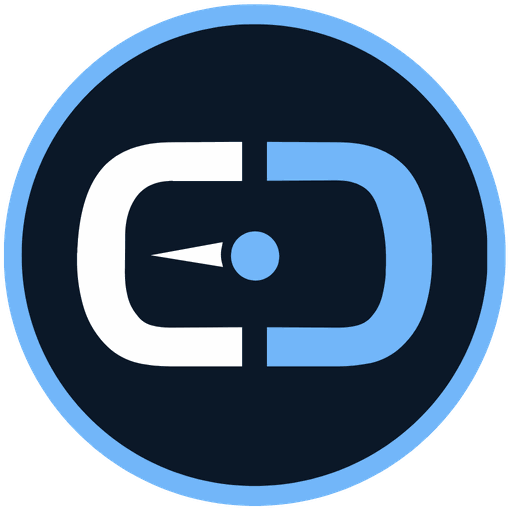

# SuiteDash MCP Server (Official)



This is the official SuiteDash MCP server. It lets you hook your A.I. assistant (Claude, ChatGPT, Codex, Cursor and others) up to your SuiteDash portal, so it can find, create and update your records for you, as you, with your own permissions.

```
https://app.suitedash.com/mcp
```

## What this repo is

This repo holds the install files for our remote server. There's no code to run on your machine and no API key to copy. You add the address above to your A.I. app, sign in with your normal SuiteDash login (including 2FA), and press **Allow**. Your A.I. app never sees your password.

This is the official SuiteDash server, listed in the [Official MCP Registry](https://registry.modelcontextprotocol.io/v0/servers?search=com.suitedash) as `com.suitedash/suitedash`. Other servers with "suitedash" in the name, such as the ones listed under `dev.cotlet` and `io.usefulapi`, are third-party wrappers. They aren't built or supported by SuiteDash.

Files in here:

| File | What it's for |
|---|---|
| `server.json` | Official MCP Registry entry |
| `mcp.json` | Drop-in config for MCP apps that read `mcpServers` |
| `gemini-extension.json` | Gemini CLI extension |
| `plugin.json`, `.cursor-plugin/plugin.json` | Plugin manifests (Cursor and others) |
| `skills/suitedash-setup/SKILL.md` | A setup skill your A.I. assistant can follow |
| `llms-install.md` | Short install steps for A.I. coding agents |
| `assets/` | Logo files |

## What you can do

Just ask in plain words. A few to try:

- "Find every client tagged Onboarding and show their open projects."
- "Create a task for Sarah on the Website Redesign project, due Friday."
- "Add a new lead for Acme Co. with Jane Doe as the primary contact."
- "What Skills does my account have? Run the Lead Follow-up skill for Jane Doe."
- "Which invoices are still unpaid?"

Your app gets about 160 Tools, each one doing what a screen in your portal does:

| Area | What it covers |
|---|---|
| CRM | Find, read, create, update and delete Contacts, Companies and Notes; add or remove Tags; manage Circles; link a Contact to a Company; convert a Contact's Role; set Follow-ups; send a Portal Access Invitation |
| Projects and Tasks | Find, read, create, update, archive and delete Projects and Tasks; apply a Project Template; add subtasks and comments; handle Work Requests |
| Office | Find and read Invoices, Estimates, Proposals, Payments and Subscriptions; create and update Invoice drafts, Estimates and Proposals; add Items; record a payment; track Expenses |
| Deals | Find, create, update, move, close and reopen Deals, and read the Deal forecast |
| Time tracking | Start, pause and finish timers, log time and bill it |
| Staff and Teams | Find and read colleagues and Teams, add or update a Staff member, and manage Teams |
| Reports | Run reports such as Sales Pipeline, Invoice Status, Payments Received, Profit and Loss, Timesheets and Overdue Tasks |
| Skills | List the Skills enabled for you and run one through an Agent |

Some Tools also need your plan to include that feature. For example, the Proposal Tools need Proposals and the Deal Tools need Deals. Each person is offered only the Tools an admin switched on for them that the account's plan includes.

What it doesn't do: set up your Custom URL, Payment Gateways, Forms or FLOWs. It can't see any other SuiteDash account.

## Who can use it

- **Staff only.** Clients and Prospects can't connect an A.I. app.
- **Your permissions, nothing more.** Your assistant sees only what your own SuiteDash screens show you and can only do what your role allows.
- **The Super Admin can always connect**, with every Tool and Skill, and that can't be switched off. Other Staff roles start switched off.
- **Your account needs the A.I. Service or an active A.I. Connection.** Without one, your A.I. app still connects but sees no Tools. A new free trial already includes the A.I. Service's free monthly tier, so it's ready.

### Turn on MCP Access for your team

The Super Admin, Admins and Account Managers can do this.

1. Open the Flyout Menu (click your profile image) and choose **A.I. Studio**.
2. Click the **MCP Access** tab. It lists your Staff roles.
3. Open a role and turn **MCP Access** on.
4. Under **Tools** and **Skills**, choose what that role's connected apps may use. Every Tool and Skill starts on once access is on.
5. Save. Everyone with that role gets these settings, including Staff you add later.

To give one person different settings, open **Manage Staff**, open that person's row menu and choose **MCP Access**. That person keeps their own settings, shown as Custom MCP Access, until you click **Back to Role Defaults**.

Turning a role's access off disconnects the A.I. apps of everyone following that role. Staff with Custom settings keep their access.

### Connect your own app

Staff with access connect from **My Account > Connections**. The **Connected A.I. Apps** card shows the steps, your MCP Address with a Copy button, and a Setup Prompt for coding assistants. The card only shows up once MCP Access is on for you.

If your portal runs on your own web address, your MCP Address is that address followed by `/mcp`, for example `https://portal.yourbusiness.com/mcp`. Use the address from your own Connected A.I. Apps card. An address belonging to another account won't connect, even if you can sign in there.

Tip: set up your Custom URL before you connect. Changing your portal's address later disconnects every A.I. app connected to it.

## Connect in your A.I. app

Before you start, your account needs the A.I. Service or an active A.I. Connection, and MCP Access has to be on for you. In every app the steps are the same: add the server address, sign in to SuiteDash when asked, press **Allow**. Swap in your own MCP Address if your card shows a different one.

### Claude (claude.ai and Claude Desktop)

1. Open **Customize > Connectors**.
2. Click **+**, then **Add custom connector**.
3. Name it **SuiteDash** and paste `https://app.suitedash.com/mcp`.
4. Click **Connect**, sign in to SuiteDash, press **Allow**.

### Claude Code

```bash
claude mcp add --transport http suitedash https://app.suitedash.com/mcp
```

Then type `/mcp` in Claude Code, pick **suitedash** and sign in.

### ChatGPT (web)

1. Go to **Plugins**, click **+**, then **Add custom MCP server**.
2. Name it **SuiteDash** and enter `https://app.suitedash.com/mcp` as the Server URL.
3. Choose **OAuth** for authentication.
4. Click **Create as a plugin**, install it, then sign in to SuiteDash and press **Allow**.
5. In a chat, type `@SuiteDash` to use it.

Custom MCP servers depend on your ChatGPT plan and workspace settings. On Business and Enterprise workspaces, an admin may need to add it.

### ChatGPT desktop app (Codex)

1. Open **Settings > Integrations > Plugins**, click **Add**, then **Add MCP server**. (Older versions: Settings > MCP servers > Add server.)
2. Name it SuiteDash, set **Type** to **Streamable HTTP**, and enter `https://app.suitedash.com/mcp` as the **URL**.
3. Leave **Bearer token env var** and **Headers** empty. Click **Save**.
4. Click **Authenticate**, sign in to SuiteDash and press **Allow**.

### Codex CLI

```bash
codex mcp add suitedash --url https://app.suitedash.com/mcp
codex mcp login suitedash
```

### Cursor

Add to `~/.cursor/mcp.json` (or your project's `.cursor/mcp.json`):

```json
{
  "mcpServers": {
    "suitedash": { "url": "https://app.suitedash.com/mcp" }
  }
}
```

Cursor opens the SuiteDash sign-in the first time a tool runs.

### VS Code (GitHub Copilot agent mode)

Add to `.vscode/mcp.json`:

```json
{
  "servers": {
    "suitedash": { "type": "http", "url": "https://app.suitedash.com/mcp" }
  }
}
```

### Gemini CLI

Add to `~/.gemini/settings.json`:

```json
{
  "mcpServers": {
    "suitedash": { "httpUrl": "https://app.suitedash.com/mcp" }
  }
}
```

### Cline and other MCP apps

Add a remote MCP server using Streamable HTTP with only the address `https://app.suitedash.com/mcp`. Don't add an API key or an Authorization header. The app handles sign-in.

## Safety and limits

**Does it ask before it changes something?**

- Finding and reading never ask. They change nothing.
- Five creates run without asking, because what they make is visible only to your staff: a draft Invoice, a draft Estimate, a draft Proposal, an Expense and a Circle. No Client sees them until someone on your team acts on them.
- Every other create, change or delete asks you first. Your A.I. app shows the request and waits for you to approve it.
- Anything that emails a Client asks first.
- It never charges a card or sends funds. Recording a payment, changing a balance or canceling a Subscription asks you first.
- If your A.I. app resends the same request within 15 minutes, SuiteDash returns the first result instead of doing it twice.

Read each approval before you click. A connected app can send a Portal Access Invitation, record a payment or delete a record if your role allows it, and a sent invitation can't be taken back.

**Limits.** Each connected app can make up to 60 requests a minute. Each person can make up to 120 a minute across all their apps, and the whole account up to 600 a minute. There's no daily limit.

**Tokens.** Access tokens last 1 hour. Refresh tokens expire after 30 days without use, or when you disconnect.

**Disconnecting.** Go to **My Account > Connections** and click **Disconnect** next to an app. It stops at once. An admin can disconnect a colleague's app from **Manage Staff** (row menu > MCP Access). Your portal also disconnects an app on its own when, for example, your password or two-step sign-in changes, you sign out of all devices, your access is turned off, you leave the team, or the portal's address changes.

**Privacy.** When your assistant calls a tool, SuiteDash returns the records that tool asked for, limited to what your permissions allow. The A.I. app's provider receives that data under its own terms. SuiteDash logs each call (time, app, person, tool) and keeps it for 90 days. SuiteDash does not use your MCP traffic to train A.I. models. See our [privacy policy](https://suitedash.com/privacy-policy/).

**Cost.** Finding, reading and changing records doesn't use your A.I. usage. Running a Skill from your A.I. app does, and it shows in your A.I. usage as Skill Runs from MCP Apps. Your A.I. app's own subscription (your Claude or ChatGPT plan, for example) is separate.

## Links

- Connector page: https://suitedash.com/mcp-connector/
- Help article: https://help.suitedash.com/article/729-mcp-connect-ai-app
- Official MCP Registry listing: https://registry.modelcontextprotocol.io/v0/servers?search=com.suitedash
- Support: help@suitedash.com

## New to SuiteDash?

SuiteDash is the all-in-one business platform trusted by 20,000+ businesses. Start a [30-day free trial, no credit card required](https://suitedash.com/free-trial/), and connect your A.I. assistant from day one.

Work smarter. Live better. We've got your back!
